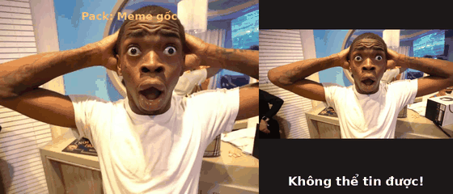
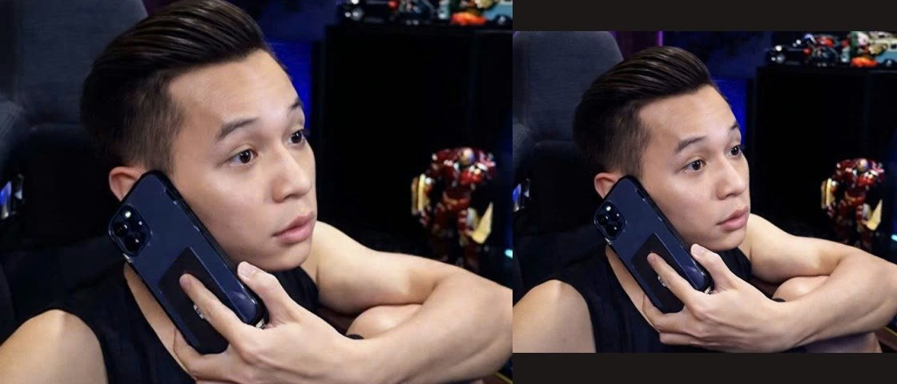
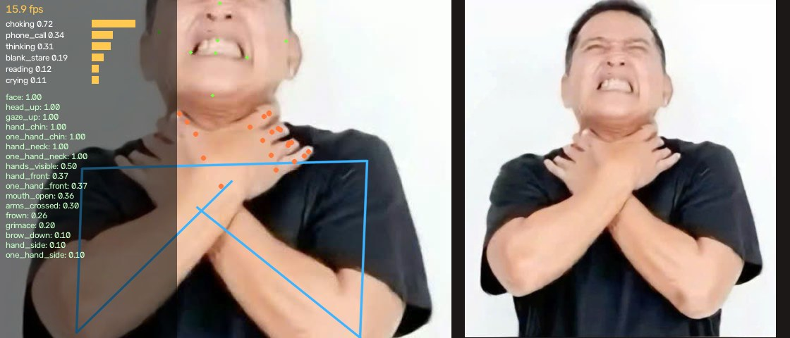

# Hướng dẫn sử dụng Memtion

Memtion mở webcam, nhìn khuôn mặt, tay và tư thế của bạn, rồi hiện **meme có tư thế/biểu cảm giống bạn nhất**
ngay bên cạnh hình camera. Bạn đổi tư thế thì meme đổi theo.



> Ảnh demo trong tài liệu này được chụp từ app thật đang chạy, nhưng nguồn hình "camera" là các ảnh người thật
> có sẵn trong `Sample_Meme/` thay vì webcam. Khi bạn dùng, nửa bên trái sẽ là chính bạn.

---

## 1. Cài đặt

### Cách 1: tải bản build sẵn (không cần cài Python)

Vào trang [Releases](https://github.com/QinZinn/Memtion/releases/latest), tải file đúng hệ điều hành:

| Máy của bạn | Tải file |
|---|---|
| Windows 10/11 64-bit | `Memtion-…-windows-x64.zip` |
| Mac chip Apple (M1, M2, M3…) | `Memtion-…-macos-arm64.zip` |
| Linux x86_64 (Ubuntu 22.04 trở lên…) | `Memtion-…-linux-x64.tar.gz` |

Chưa có bản cho Mac chip Intel vì MediaPipe (thư viện nhận diện) không hỗ trợ nền tảng này.

**Windows**
1. Giải nén file zip.
2. Mở thư mục `memtion`, chạy `memtion.exe`.
3. Nếu Windows hiện "Windows protected your PC" (app chưa ký số): bấm **More info → Run anyway**.

Một cửa sổ đen (console) sẽ mở kèm theo để hiện thông báo; đừng tắt nó khi đang dùng app.

**macOS**
1. Giải nén ra `Memtion.app`.
2. App chưa được Apple ký nên lần đầu macOS sẽ chặn. Mở **Terminal** và chạy (đổi đường dẫn nếu bạn để app chỗ khác):
   ```bash
   xattr -dr com.apple.quarantine ~/Downloads/Memtion.app
   ```
3. Mở `Memtion.app`, bấm **Cho phép (OK)** khi macOS hỏi quyền dùng camera.
   Nếu lỡ bấm từ chối: **System Settings → Privacy & Security → Camera**, bật Memtion.

**Linux**
```bash
sudo apt install libegl1 libgles2
```
```bash
tar -xzf Memtion-*-linux-x64.tar.gz
```
```bash
./memtion/memtion
```

### Cách 2: chạy từ mã nguồn

Cần Python 3.11 trở lên. Xem phần **Cài đặt** trong [README](../README.md#cài-đặt-linux).

---

## 2. Màn hình chính


- **Bên trái**: hình camera (đã lật như gương, nên giơ tay phải thì hình cũng giơ bên phải).
- **Bên phải**: meme đang khớp nhất. Mặc định chỉ có ảnh, không có chữ; bấm **`l`** nếu muốn hiện tên meme bên dưới.
- Dòng chữ vàng phía trên camera (ví dụ `Pack: Meme gốc`) chỉ hiện vài giây khi mở app hoặc khi đổi pack.

Meme không đổi ngay lập tức mà đợi bạn giữ tư thế khoảng **nửa giây**, để không nhấp nháy khi bạn lỡ cử động.
Nếu không tư thế nào khớp đủ rõ, app hiện meme "mặc định" của pack (Spongebob ở pack gốc, mặt "..." ở pack Blob).

---

## 3. Bắt đầu nhanh

1. Ngồi sao cho camera thấy **mặt, vai và hai tay** của bạn, cách camera khoảng một cánh tay.
2. Đảm bảo **đủ sáng**, tốt nhất ánh sáng chiếu vào mặt chứ không phải từ sau lưng.
3. Nhìn thẳng camera với **mặt bình thường** rồi bấm phím **`c`** (hiệu chỉnh). Giữ yên khoảng 1 giây cho tới khi
   dòng "Giữ mặt bình thường..." biến mất.
   Bước này giúp app biết "mặt bình thường" của bạn ra sao, và cũng bù cho việc webcam laptop đặt cao hơn mắt.
4. Thử các tư thế ở mục 5 và 6.

---

## 4. Phím tắt

Bấm phím khi cửa sổ Memtion đang được chọn (click vào cửa sổ trước).

| Phím | Tác dụng |
|---|---|
| `p` | Đổi pack meme (Meme gốc ↔ Blob) |
| `c` | Hiệu chỉnh mặt trung tính (nên làm mỗi lần đổi chỗ ngồi hoặc ánh sáng) |
| `d` | Bật/tắt chế độ debug (xem mục 7) |
| `l` | Bật/tắt tên meme (chú thích) bên dưới ảnh meme, mặc định tắt |
| `m` | Bật/tắt lật gương |
| `s` | Chụp màn hình, lưu vào thư mục `Pictures/Memtion` (hoặc `Memtion` trong thư mục nhà) |
| `q` hoặc `Esc` | Thoát |

---

## 5. Pack "Meme gốc": tư thế tay và cơ thể

Pack này mạnh về **tư thế tay**. Làm rõ ràng, dứt khoát, để tay trong khung hình.

| | |
|---|---|
|  |  |
| **Hai tay ôm đầu + há miệng + mở to mắt** → "Không thể tin được!" | **Một tay áp lên tai** như nghe điện thoại → "Alo, nghe nè?" |
|  |  |
| **Giơ cả hai tay lên cao quá đầu** → "Tự do rồi!" | **Tay ôm cổ + nhăn mặt** → "Nghẹt thở luôn á" |

Toàn bộ 20 meme (cột "Meme" ghi tên meme, là chữ hiện ra khi bạn bật chú thích bằng phím `l`):

| Làm thế này | Meme |
|---|---|
| Giơ hai tay lên cao quá đầu | Tự do rồi! (bẻ xích) |
| Giơ ngón cái 👍 | Ok, duyệt! (mèo like) |
| Chỉ ngón trỏ (các ngón khác nắm lại), há miệng | Nhìn kìa! (wojak chỉ tay) |
| Hai tay ôm đầu, há miệng, mở to mắt | Không thể tin được! |
| Hai tay che má/mắt, nhíu mày buồn | Huhu... (hải ly khóc) |
| Hai tay chống cằm + cười | Dễ thương hông? |
| Tay ôm cổ, nhăn mặt | Nghẹt thở luôn á |
| Một tay áp lên tai | Alo, nghe nè? |
| Một tay đặt lên đầu / sau gáy, mỉm cười | Hehe, biết rồi (thỏ hồng) |
| Khoanh tay / tự ôm mình, mỉm cười | Tự ôm bản thân |
| Một tay chống cằm + quay mặt sang bên | Để suy nghĩ đã... (mèo) |
| Một tay chống cằm (+ nhìn lên trên) | Hmm... (khỉ) |
| Cúi đầu nhìn xuống thứ đang cầm trước ngực | Đọc kỹ lại xem nào |
| Cười to, há miệng | Hahaha! |
| Cười tươi, miệng khép | Hí hí |
| Nhắm mắt + ngẩng mặt lên | Phê... |
| Nghiêng đầu sang một bên, không cười | Hả??? |
| Quay mặt sang bên, tay để xa mặt | Sói cô độc |
| Nghiêng vai (như dựa tường) + cúi đầu | Mệt mỏi quá rồi |
| Mặt buồn, hoặc không làm gì đặc biệt | ... (Spongebob, meme mặc định) |

---

## 6. Pack "Blob": biểu cảm khuôn mặt

Bấm **`p`** để chuyển sang pack này. Pack Blob "đọc mặt" là chính, nên hãy **làm biểu cảm thật rõ** (hơi phóng đại
càng tốt) và để mặt đủ sáng.

| | |
|---|---|
|  |  |
| Há to miệng + nhướn mày + mở to mắt → "Kinh hoàng!" | Tay đặt ở miệng/cằm, không cười → "Thở oxy gấp" |

Cột "Meme" ghi tên meme (hiện ra khi bật chú thích bằng phím `l`).

| Làm thế này | Meme |
|---|---|
| **Miệng há to** | |
| Cười to, há miệng | Hahaha |
| Cười há miệng + nheo/nhắm mắt | Cười điên dại |
| Há miệng + nhướn mày + nhắm/nheo mắt | Khóc như mưa |
| Há miệng + nhướn mày + mở to mắt | Kinh hoàng! |
| Há miệng + nhíu mày | Tức điên! |
| Há miệng + nhắm mắt (mệt) | Nóng quá trời |
| Trễ môi buồn + hé miệng | Sao lại thế... |
| Chỉ há miệng, mặt không biểu cảm gì khác | AAAAA |
| Nghiêng đầu + hé miệng | Lêu lêu |
| **Cười, miệng khép** | |
| Cười + mở to mắt | Cười gượng như hề |
| Cười + nheo mắt | Hí hí |
| Nhắm mắt + mỉm cười nhẹ | Thư giãn... |
| Cười + cúi đầu | Ngại quá à |
| Cười + nghiêng đầu | Tinh nghịch |
| Cười nhếch một bên mép | Có âm mưu |
| Mỉm cười bình thường | Cười mỉm |
| **Môi, má** | |
| Chu môi + nhắm mắt | Chụt! |
| Chu môi, mắt mở | Môi chu chu |
| Phồng hai má | Phồng má |
| Mím môi | Mím môi tủi thân |
| **Tay** | |
| Ngón cái chúc xuống 👎 | Không ổn rồi |
| Ngón cái giơ lên 👍 | Chuẩn không cần chỉnh |
| Hai tay đưa lên gần mặt + cười (như bắn tim) | Thương thương |
| Tay ở miệng/cằm, không cười | Thở oxy gấp |
| Cầm một thứ trước ngực + cười | Tặng bạn nè |
| Ló mặt ra từ mép trái/phải khung hình | Ló mặt xem thử |
| **Khác** | |
| Trễ môi + nhướn mày (lo lắng) | Lo lắng |
| Nhíu mày + trễ môi | Khó chịu ghê |
| Chỉ nhíu mày | Nghiêm túc |
| Cúi đầu, không cười | Đang làm việc |
| Mặt bình thường | ... (meme mặc định) |

Pack này không có meme cho "nghe điện thoại" hay "giơ hai tay"; làm các tư thế đó sẽ ra meme mặc định "...".
Muốn dùng chúng thì chuyển về pack gốc.

---

## 7. Chế độ debug: tại sao app chọn meme này?

Bấm **`d`** để bật.



- **Số fps** ở góc trên: số khung hình xử lý mỗi giây. Dưới khoảng 10 thì app sẽ phản ứng chậm (xem mục 9).
- **Các thanh màu vàng**: 6 meme có điểm cao nhất. Meme được hiện phải đứng đầu và vượt mức tối thiểu 0,5.
  Trong ảnh trên, `choking` 0.72 dẫn trước hẳn `phone_call` 0.34.
- **Danh sách chữ xanh**: các "đặc trưng" app đang đo được, từ 0 đến 1. Ví dụ `hand_neck: 1.00` nghĩa là chắc chắn
  có tay ở cổ, `grimace: 0.19` là hơi nhăn mặt.
- **Chấm và đường trên hình**: chấm xanh lá là điểm trên mặt, chấm cam là bàn tay, đường xanh dương là vai và tay.
  Nếu không thấy chấm cam trên tay bạn, nghĩa là app không thấy tay đó.

Mẹo: nếu một tư thế mãi không ra, bật debug lên, làm tư thế đó và xem đặc trưng nào **không** sáng lên. Thường là
tay ra khỏi khung hình, hoặc biểu cảm chưa đủ rõ.

---

## 8. Mẹo để nhận diện tốt

- **Ánh sáng**: đủ sáng và chiếu vào mặt. Ngược sáng (cửa sổ sau lưng) là nguyên nhân số 1 khiến biểu cảm bị đọc sai.
- **Khoảng cách**: thấy được từ đầu tới ngực. Quá gần thì mất tay, quá xa thì biểu cảm mặt khó đọc.
- **Làm rõ ràng**: há miệng thì há hẳn, cười thì cười rõ. App đo biểu cảm theo mức độ, làm nửa vời sẽ ra meme "bình thường".
- **Giữ tư thế** khoảng nửa giây để meme kịp đổi.
- **Hiệu chỉnh lại (`c`)** khi đổi chỗ ngồi, đổi ánh sáng, hoặc thấy app hay nhận nhầm "cúi đầu"/"ngẩng đầu".
- Chỉ nên có **một người** trong khung hình; app chỉ theo dõi một khuôn mặt.

---

## 9. Xử lý sự cố

| Vấn đề | Cách xử lý |
|---|---|
| "Không mở được camera" | Đóng các app khác đang dùng camera (Zoom, Meet, OBS…). Có nhiều camera thì chạy `memtion --camera 1`. macOS: cấp quyền camera (mục 1). Linux: kiểm tra `ls /dev/video*`. |
| Chỉ hiện meme mặc định dù đã làm tư thế | Bật debug (`d`): nếu không có chấm xanh lá trên mặt thì camera không thấy mặt, hãy ngồi vào giữa khung và bật thêm đèn. Nếu có chấm, xem đặc trưng nào còn thiếu (mục 7). |
| Meme nhảy lung tung | Bấm `c` để hiệu chỉnh lại; kiểm tra ánh sáng; tránh để người khác lọt vào khung. |
| App chậm, giật | Chạy `memtion --fast` (dùng model cơ thể nhẹ hơn). Đóng bớt app nặng. |
| Linux: lỗi `libEGL.so.1` | `sudo apt install libegl1 libgles2` |
| Linux Wayland: không hiện cửa sổ | Chạy `QT_QPA_PLATFORM=xcb ./memtion/memtion` |
| macOS: "app is damaged / cannot be opened" | Chạy lệnh `xattr` ở mục 1. |
| Windows: SmartScreen chặn | More info → Run anyway. |

---

## 10. Tuỳ chọn dòng lệnh

Chạy từ terminal (Windows: mở `cmd` trong thư mục `memtion`, gõ `memtion.exe ...`):

| Lệnh | Tác dụng |
|---|---|
| `memtion --pack blob` | Mở thẳng pack Blob |
| `memtion --list` | Xem danh sách pack và meme |
| `memtion --camera 1` | Dùng camera thứ hai |
| `memtion --fast` | Chạy nhanh hơn trên máy yếu |
| `memtion --debug` | Bật debug ngay từ đầu |
| `memtion --no-mirror` | Không lật gương |
| `memtion --labels` | Bật sẵn tên meme bên dưới ảnh |
| `memtion --image anh.jpg --out ketqua.jpg` | Phân tích một ảnh tĩnh, in điểm số, lưu ảnh kết quả |

---

## 11. Thêm meme hoặc pack của riêng bạn

Mỗi pack là một file `.toml` liệt kê ảnh meme và tư thế ứng với từng ảnh. Muốn tự làm pack:

1. Tạo thư mục pack trong thư mục cấu hình người dùng:
   - Windows: `%APPDATA%\memtion\packs`
   - macOS: `~/Library/Application Support/memtion/packs`
   - Linux: `~/.config/memtion/packs`
2. Chép ảnh meme vào đó và tạo file, ví dụ `cua-toi.toml`:
   ```toml
   [pack]
   name = "Của tôi"

   [settings]
   fallback = "binh_thuong"

   [[meme]]
   id = "cuoi_to"
   file = "cuoi.png"
   label = "Hahaha"   # tên meme, chỉ hiện khi bật chú thích (phím l)
   when = { smile = 1.0, mouth_open = 1.0 }

   [[meme]]
   id = "binh_thuong"
   file = "binh_thuong.png"
   label = "..."
   when = { face = 1.0 }
   not = { smile = 0.5, mouth_open = 0.5 }
   ```
3. Mở lại app và bấm `p` cho tới khi thấy `Pack: Của tôi`.

Danh sách đầy đủ các đặc trưng (`smile`, `mouth_open`, `hand_chin`…) và cách tính điểm có trong phần đầu file
[`packs/default.toml`](../packs/default.toml). Bật debug (`d`) để xem đặc trưng nào sáng lên khi bạn làm một tư thế,
rồi đưa chúng vào `when`.
